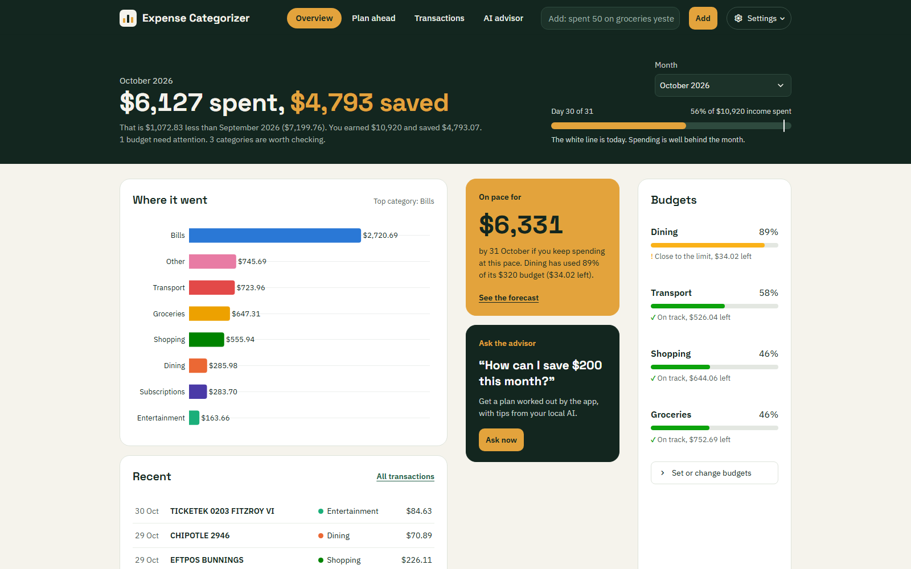
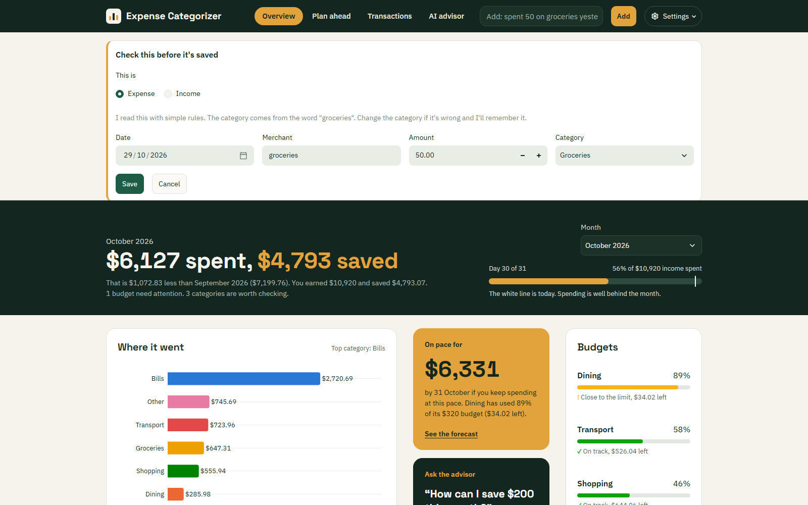
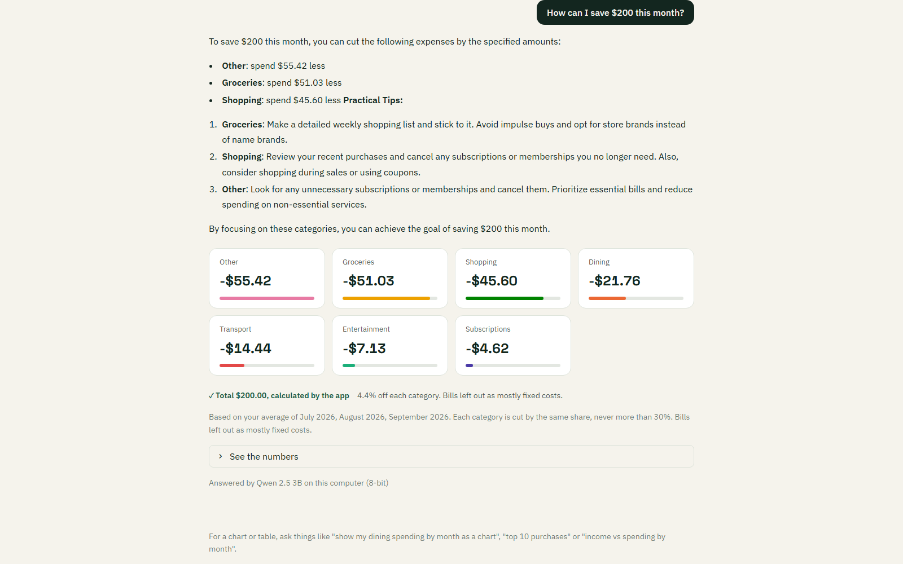
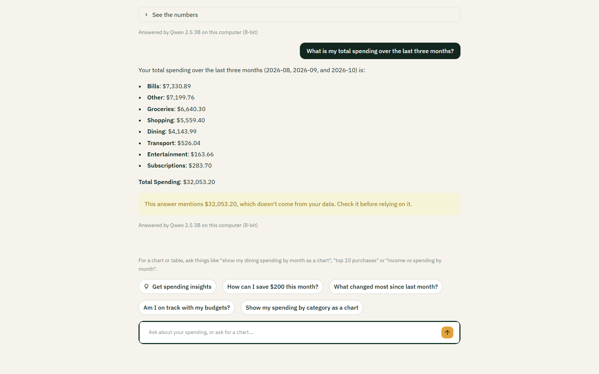

# AI Finance Advisor

AI Finance Advisor (the app is titled "Expense Categorizer" on screen) is a private personal finance app
that runs on your own computer. You type purchases in plain English ("spent 50 on groceries yesterday") or
import a bank CSV. A machine learning model categorizes each transaction, says how sure it is, and learns
from your corrections. The app then shows budgets, a month-end forecast and savings, and a local AI advisor
answers questions about your spending. One rule runs through the whole design: **code does the maths, the
AI only explains**. Every total, forecast and savings plan is calculated by Python, and every dollar amount
or percentage the AI writes is checked against your real data.

## Try the demo

The demo account is not included in this repository, because the app's database is not committed. Create it
first (after the [setup](#setup-windows-powershell) steps below). It loads realistic Australian transactions
that end today, adds salary and sets budgets. Running it again rebuilds the account.

```bash
python src/make_demo_account.py
```

For the AI advisor, Ollama must be running with this model pulled:

```bash
ollama pull qwen2.5:3b-instruct-q8_0
```

Start the app, then open the address it prints (usually http://localhost:8501):

```bash
streamlit run src/dashboard.py
```

Log in with:

- Username: **demo**
- Password: **demo1234**

The first AI answer can take 40 to 60 seconds while the model loads; after that, answers take about 10 to 17
seconds. Questions to try in the AI advisor:

- "How can I save $200 this month?"
- "What changed most since last month?"
- "Show my spending by category as a chart"

## Features

- **Typed sentence entry**: "paid $12.50 at Starbucks yesterday", "got paid 2000 salary". Rules read the amount, the
  date (Australian, day-first) and the merchant. The local AI only steps in when the rules miss, and you confirm before
  anything is saved.
- **Categorization with a confidence score**: MiniLM sentence embeddings + LightGBM, plus keyword hints for Australian
  shops. Anything under 60% sure goes to a "Worth a second look" list.
- **Learns from corrections**: change a category once and the app remembers that merchant and fixes earlier
  transactions from it.
- **CSV import** that skips transactions already in your account.
- **Budgets** per category, with a warning at 80% and an alert when you go over.
- **Income and savings**: savings per month and savings rate.
- **Plan ahead**: a month-end forecast (run-rate) and "what if I spent less?" sliders.
- **AI advisor**: local Qwen 2.5 3B through Ollama (or Groq in the cloud, optional). Savings plans that add up
  exactly, charts and tables calculated by code, and a warning when an answer mentions a number that isn't in your
  data.
- **Accounts**: passwords stored as salted PBKDF2 hashes; every query is filtered by user.

## Screenshots

The Overview (demo account):



Typing a purchase: the app shows what it read and why it picked the category, before saving:



The AI advisor's savings plan. The numbers are calculated by the app; the AI writes the tips:



The number check: amounts that don't come from your data are flagged:



## How it works

### The pipeline

1. **Input**: a typed sentence (`src/nl_entry.py`), a form, or a CSV file (`read_bank_csv` in `src/clean_data.py`).
2. **Clean**: `clean_merchant` removes card-processor prefixes, store numbers and punctuation
   ("VISA PURCHASE KMART 0099" becomes "KMART"). The date, day of week and a "recurring" flag are added.
3. **Categorize** (`src/categorizer.py`), in this order, where later steps win:
   - the **MiniLM** model (`all-MiniLM-L6-v2`) turns the merchant name into 384 numbers that capture its meaning;
   - **LightGBM** reads those numbers plus the amount and date and gives a probability for each of 8 categories.
     The highest is the category and its probability is the confidence;
   - **keyword hints** (`src/category_hints.py`) fix plain words and Australian shops ("coffee", "Coles", "Opal");
   - **your own rules**, learned from corrections, always win.
4. **Store**: SQLite (`data/app.db`, created on first run). Every row keeps its confidence.
5. **Show**: a Streamlit app (`src/dashboard.py`) with four pages: Overview, Plan ahead, Transactions and AI advisor.

### The AI advisor

- **Local by default**: Qwen 2.5 3B (8-bit) through Ollama, so nothing leaves your computer. Groq (free cloud) is
  optional under Settings; if you choose it, your spending summary is sent to Groq's servers.
- **Code does the maths, the AI explains**: the app calculates a summary of your spending and hands it to the model.
  For savings goals ("How can I save $200 this month?"), budget questions, "what changed" questions and charts, the
  code works out the answer first and the model only explains it. Savings plans always add up exactly and never cut a
  category by more than 30%.
- **Number check**: every dollar amount and percentage in an answer is compared with the numbers the app gave the
  model. Anything that matches nothing gets a warning under the answer.

## Requirements

- **Python 3.14** (3.14.7 was used and tested). The packages are in `requirements.txt`; the versions used were
  streamlit 1.66.1, lightgbm 4.7.0, sentence-transformers 6.2.0, pandas 3.1.0, scikit-learn 1.9.1, plotly 7.1.0 and
  torch 2.15.0.
- **Ollama** ([ollama.com](https://ollama.com)) with this model:

  ```bash
  ollama pull qwen2.5:3b-instruct-q8_0
  ```

- **Hardware used**: Windows 11 laptop, Intel Core i5-11400H, 16 GB RAM, NVIDIA GeForce RTX 3050 Laptop GPU (4 GB).
  The model is 3.3 GB. The first advisor question takes longest (up to about a minute and a half) while the model
  loads; later questions took about 12 seconds on average.
- About 90 MB is downloaded on first run for the MiniLM embedding model.

## Setup (Windows PowerShell)

1. Clone the repository and go into it:

   ```bash
   git clone https://github.com/thpb/AIFINANCEADVISOR.git
   ```

   ```bash
   cd AIFINANCEADVISOR
   ```

2. Create and activate a virtual environment:

   ```bash
   python -m venv venv
   ```

   ```bash
   venv\Scripts\Activate.ps1
   ```

   (If PowerShell blocks the activation script, allow local scripts for your user account or run the commands below
   with `venv\Scripts\python.exe` instead of `python`.)

3. Install the packages:

   ```bash
   python -m pip install -r requirements.txt
   ```

4. Pull the local AI model (Ollama must be installed and running):

   ```bash
   ollama pull qwen2.5:3b-instruct-q8_0
   ```

5. The trained model files are included in `data/`, so you can skip this step. To train the app's model again
   (the result is identical to the included files):

   ```bash
   python src/train_improved_v2.py --data data/transactions_v2.csv
   ```

6. Optional: create the demo account (see [Try the demo](#try-the-demo) for the login details).

   ```bash
   python src/make_demo_account.py
   ```

7. Start the app, then open the address it prints (usually http://localhost:8501). Sign up for your own account or
   log in as demo.

   ```bash
   streamlit run src/dashboard.py
   ```

Every command above was checked on a fresh clone of this repository.

## Tests

```bash
python -m unittest discover -s tests
```

```bash
python -m unittest discover -s apptests
```

- `tests/`: **170 unit tests**, no network and no real AI model (fakes and mocks).
- `apptests/`: **23 Streamlit AppTest flows** through the real app with a mocked Ollama (needs the trained model).

Current results (2 November 2026): **all 170 unit tests and all 23 app tests pass**, both in the working copy and
in a fresh clone.

Two more useful checks:

```bash
python src/check_categories.py
```

prints how the demo sentences get categorized by the real model, and

```bash
python src/evaluate_models.py
```

reruns the model comparison below and writes `report_results.md` (about 1.5 minutes).

## Project structure

```
AIFINANCEADVISOR/
  README.md                    this file
  HOW_IT_WORKS.md              plain-English explanation of every part
  report_results.md            model results (written by evaluate_models.py)
  PROGRESS.md                  build log: phases, decisions, changes from the spec
  CLAUDE.md                    working rules for Claude Code on this project
  requirements.txt             Python packages
  .streamlit/config.toml       colours and fonts of the app
  data/
    transactions.csv           612 synthetic transactions (original generator)
    transactions_v2.csv        4,000 synthetic Australian transactions (the app's training data)
    improved_model_v2.joblib   the app's trained LightGBM model
    label_encoder_v2.joblib    category names for that model
    baseline_*.joblib          TF-IDF + Logistic Regression baseline
    models_backup_original/    the models trained on the original data
  src/
    dashboard.py               the Streamlit app (all four pages)
    ui.py                      CSS, colours, charts and small HTML helpers
    nl_entry.py                plain-English sentence parser (rules first, AI fallback)
    clean_data.py              clean_merchant(), features, reading bank CSVs
    categorizer.py             the pipeline: model, then keyword hints, then user rules
    category_hints.py          keyword hints for plain words and Australian shops
    corrections.py             merchant rules (learning) and the low-confidence review list
    db.py                      SQLite storage, duplicate check on import
    auth.py                    sign up and log in (PBKDF2 password hashing)
    budgets.py                 budget maths, 80% warning, money formatting
    planning.py                month-end forecast and the what-if saver
    savings.py                 income, savings and savings rate
    table_edits.py             turns table edits into database updates
    money_facts.py             numbers for the advisor, savings plans, the number check
    advisor.py                 Ollama / Groq calls, prompts, routing of questions to code
    advisor_charts.py          charts and tables the advisor can show, calculated by code
    train_baseline.py          trains the TF-IDF + Logistic Regression baseline
    train_improved.py          trains v1 (embeddings + LightGBM)
    train_improved_v2.py       trains v2, the app's model
    evaluate_models.py         baseline vs v2 vs v2 + hints on three tests
    diagnose_model.py          per-category scores, confusion matrix, mistakes
    check_categories.py        how sample sentences get categorized
    generate_realistic_data.py the original synthetic data
    generate_more_data.py      the larger Australian data
    generate_sample_data.py    an older, clean-only generator (kept for comparison)
    make_demo_account.py       builds the demo account
    advisor_check.py           asks the advisor five questions through the real model
    _root.py                   makes every script work from any folder
  tests/                       unit tests (helpers.py gives a throwaway database)
  apptests/test_app.py         Streamlit AppTest flows
  tools/screenshots.py         Playwright screenshots of every page
  docs/screenshots/            the screenshots in this README
```

## Model results

From `report_results.md`. Accuracy of each model on three tests:

| Test | Test rows | Baseline (TF-IDF + LogReg) | v2 (MiniLM + LightGBM) | v2 + keyword hints |
|------|-----------|----------------------------|------------------------|--------------------|
| Original data, time split | 123 | 75.6% | 87.0% | 87.8% |
| New data, time split | 800 | 86.5% | 85.6% | 87.4% |
| New data, unseen merchants | 358 | 7.3% | 42.7% | 80.2% |

**How it was tested:**

- **Time split**: train on the oldest 80% of transactions and test on the newest 20%. This matches how the app is
  used: it learns from the past and categorizes what comes next.
- **Unseen merchants**: 12 whole shops (about 10%) are held out of training completely, so the test only has shops the
  model has never seen. This is the honest test for real life. The baseline only knows words it has seen (7.3%), v2
  reads the meaning of the name (42.7%), and the keyword hints bring it to 80.2%.
- The data is synthetic, generated with `--end 2026-10-29` so the results are reproducible. About 4% of labels are
  wrong on purpose, and shops like Amazon and Costco genuinely sell things from several categories, so no model
  reaches 100%.

## Limitations

- All training data is synthetic, so accuracy on a real bank statement is likely to be lower than reported.
- The model is over-confident when it is wrong (86% average confidence on its mistakes), so the "Worth a second look"
  list catches only some mistakes. Keyword hints and your corrections do most of the fixing.
- Shops it has never seen are its weak spot: 42.7% on unseen merchants, 80.2% with keyword hints.
- A correction only applies to the exact same cleaned merchant name, so "PETBARN 22 PARRAMATTA" and "PETBARN ONLINE"
  are learned separately.
- The forecast is a simple run-rate and starts on day 5 of the month. It can't know about bills that haven't arrived
  yet.
- A 3B local model sometimes writes a wrong number. The app flags amounts and percentages that don't come from your
  data, but it can't catch a real number used in the wrong place.
- The AI engine setting applies to the whole running app, which suits one person on one computer.

## Credits and AI use

Ideas (no code) came from two MIT-licensed projects:

- [Spritan/expense_tracker](https://github.com/Spritan/expense_tracker): typed-sentence entry and income tracking.
- [nirban256/expense_tracker](https://github.com/nirban256/expense_tracker): category budgets.

No code was copied from these or any other repository.

This project was built with help from Claude (Anthropic's AI assistant) and Claude Code, which wrote and tested code
from my specification and design decisions. I reviewed, ran and checked the work, and made the decisions about what
the app should do.
